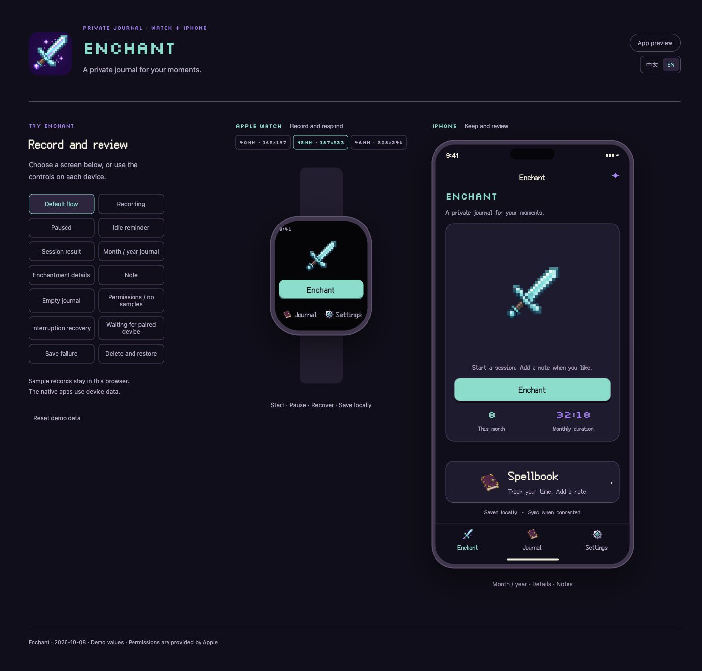
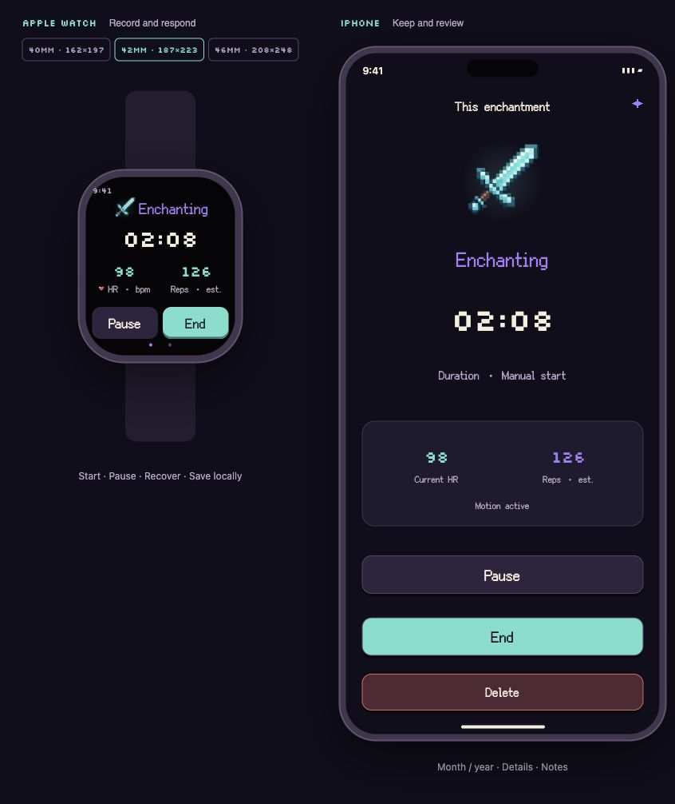
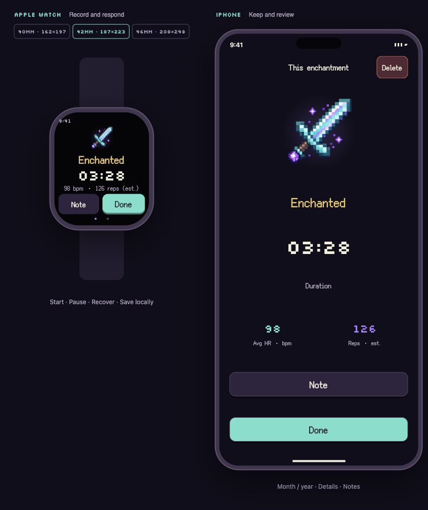

# Enchant

**A private journal for your moments.**

[English](README.md) · [简体中文](README.zh-CN.md)

  

[Project story](https://www.shuqihere.top/archive/projects/enchant) · [Feedback](https://github.com/howtoexitvim/Enchant/issues)

Enchant began with “给剑附魔” — *enchanting a sword*, a cheeky little internet joke. I turned it into a small, private journal for Apple Watch and iPhone.

You begin with a plain blade. A few sparks gather as you go. When you're done, the same sword lights up, and the moment finds a place in your Spellbook.

  

## A small ritual

Start on your watch, pause when you need to, and finish when you're ready. Enchant keeps track of active time, available heart-rate readings, and estimated movement count. A short sound marks each button press and countdown step; sound and haptics have separate controls.

With Auto Mode enabled, a steady rhythm can start a session while the watch app is open. When that rhythm stops, recording pauses and a short countdown gives you time to continue before the session ends. A manual pause stays paused until you resume.

<table>
  <tr>
    <td align="center" width="50%">
       
      A little magic in the making.
    </td>
    <td align="center" width="50%">
       
      A little glow when you're done.
    </td>
  </tr>
</table>

*These previews use sample data.*

## A record of your own

The watch handles the moment; the phone gives you room to look back. Browse your sessions by month or year, review a heart-rate chart, and add a note. The interface supports English and Simplified Chinese.

Records stay on your devices and sync between your paired watch and phone. There is no account, developer server, or analytics. The temporary HealthKit workout used for heart-rate collection is discarded when a session ends, rather than saved as a workout. This does not delete heart-rate samples that HealthKit may retain.

Auto Mode needs the watch app open and receiving motion samples; it is not an all-day background detector. Movement counts are estimates from wrist motion. A session started on iPhone records time without inventing watch sensor readings.

## Availability

**Enchant is in development, with no public download yet.** This repository contains the introduction and preview images. The application source code is not published here.

| Platform | Minimum target |
| --- | --- |
| Apple Watch | watchOS 10 |
| iPhone | iOS 17 |

Built with Swift and SwiftUI. Motion and heart-rate features depend on the watch, system permissions, and available samples.

Made by [Shuqi Wang](https://www.shuqihere.top/). Read the [project story](https://www.shuqihere.top/archive/projects/enchant), or [open an issue](https://github.com/howtoexitvim/Enchant/issues) to share feedback.

© 2026 Shuqi Wang. All rights reserved. Public visibility of this showcase does not grant a license to the application or its media.

