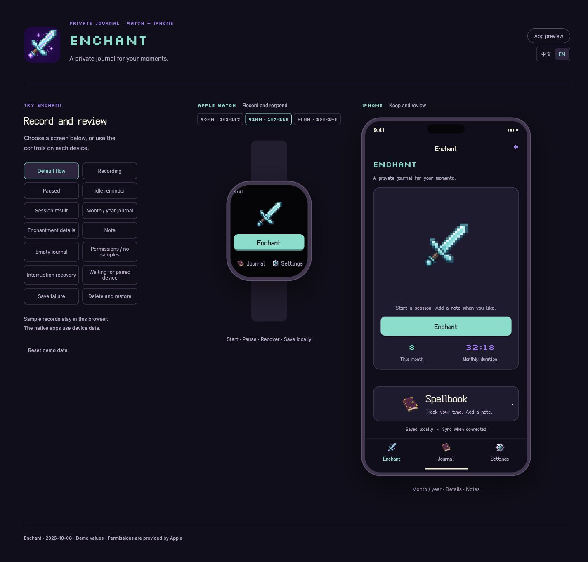
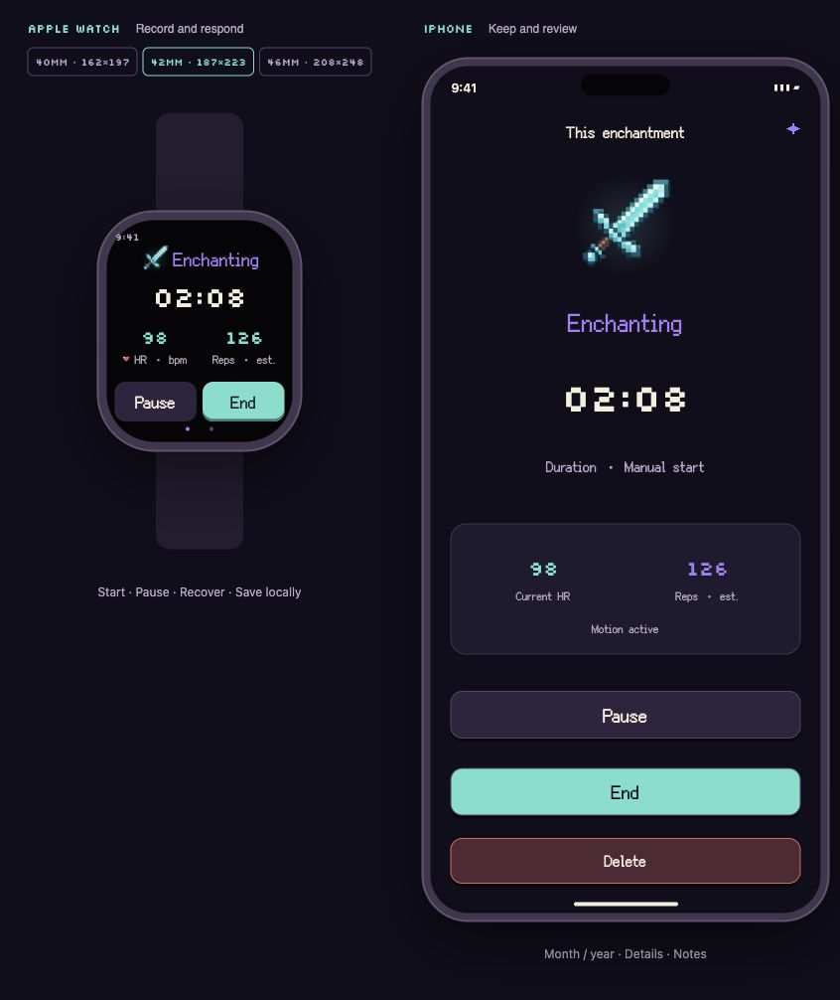
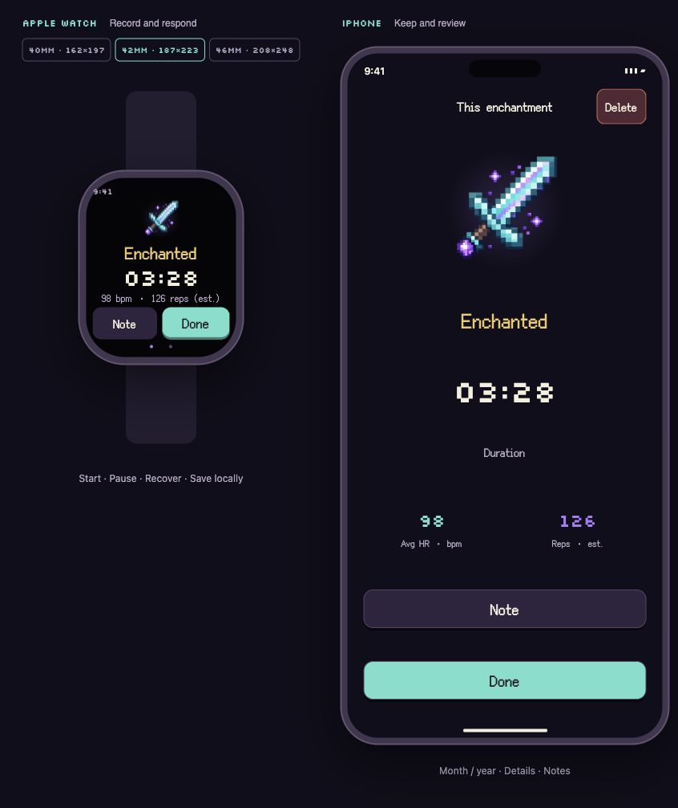

# Enchant

**给自己的时刻，留一本私人手账。**

[English](README.md) · [简体中文](README.zh-CN.md)

  

[项目故事](https://www.shuqihere.top/archive/projects/enchant) · [反馈建议](https://github.com/howtoexitvim/Enchant/issues)

Enchant 从「给剑附魔」这个梗开始。我把这个小玩笑，做成了 Apple Watch 和 iPhone 上的一本私人手账。

开始时是一把普通的剑。过程中，剑身渐渐聚起星点；结束后，同一把剑亮起来，这段时刻便收进了你的魔法手账。

  

## 一个小小的仪式

在手表上开始，需要时暂停，准备好后结束。Enchant 记录活动时长、可用的心率读数和估算动作次数。按键与倒计时有简短音效，声音和触感可以分别设置。

开启自动模式后，手表应用打开时，持续稳定的节奏可以触发记录。节奏停下，计时便暂停，并进入短暂倒计时；你可以继续，也可以让这次记录自然结束。手动暂停后，需要手动恢复。

<table>
  <tr>
    <td align="center" width="50%">
       
      一点点魔法，正在发生。
    </td>
    <td align="center" width="50%">
       
      完成后，留下一点光。
    </td>
  </tr>
</table>

*预览画面使用样例数据。*

## 留给自己看

手表负责当下，手机留出回顾的空间。按月或年翻看记录，看看心率曲线，再写下一句备注。界面支持简体中文与英文。

记录保存在自己的设备上，通过配对的手表和手机同步。没有账号、开发者服务器或分析追踪。读取心率所用的临时 HealthKit 训练会话会在结束时丢弃，不保存为一条训练记录；这不代表删除 HealthKit 可能保留的心率样本。

自动模式需要手表应用保持打开并收到动作样本，不是全天后台检测。动作次数来自腕部信号估算。在 iPhone 上单独开始时只记录时间，不虚构手表的传感器读数。

## 当前状态

**Enchant 仍在开发中，暂未提供公开下载。** 本仓库用于展示项目介绍与预览图片，不包含应用源码。

| 平台 | 最低目标版本 |
| --- | --- |
| Apple Watch | watchOS 10 |
| iPhone | iOS 17 |

使用 Swift 与 SwiftUI 开发。动作和心率功能取决于手表、系统权限及实际可用的样本。

由 [Shuqi Wang](https://www.shuqihere.top/) 制作。可以阅读[项目故事](https://www.shuqihere.top/archive/projects/enchant)，也欢迎[提交 Issue](https://github.com/howtoexitvim/Enchant/issues) 分享建议。

© 2026 Shuqi Wang。保留所有权利。本展示仓库的公开可见性不代表授予应用或媒体素材的使用许可。
